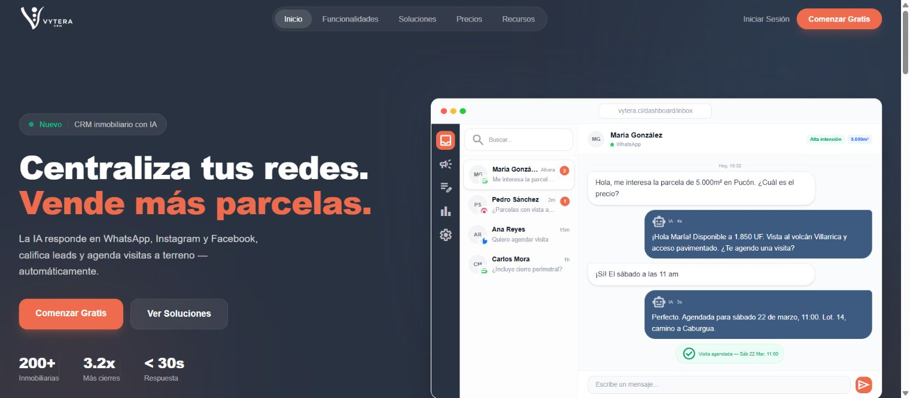
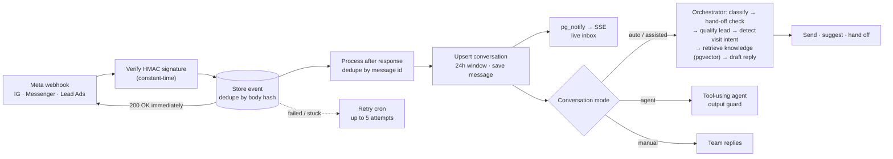

# Vytera — AI-Powered CRM for Real Estate Sales

**One workspace where every Instagram, Messenger, and WhatsApp conversation is tied to a lead, a property, and the next sales step — with an AI assistant the team stays in control of.**

[**Live website**](https://www.vytera.cl) · [Marco Alvarado](https://github.com/7pixel-cl) · [Portfolio](https://7pixel.cl) · [LinkedIn](https://www.linkedin.com/in/marcoalvaradot/)

**[Read the full case study online →](https://7pixel-cl.github.io/vytera-showcase/)**

> Production source is private. This repository is a public case study with approved imagery — no code, customer data, or internal schemas.

*Public Vytera landing page with an illustrative inbox demo (October 2026). Names and figures in the image are illustrative.*

## At a glance

| | |
| --- | --- |
| **Role** | Sole engineer — product design, architecture, AI, integrations, and deployment |
| **Timeline** | March 2026 – present (~200 commits) |
| **Status** | Live SaaS with plans, subscriptions, and AI credits |
| **Scale of the codebase** | ~79k lines of TypeScript · 47 tables · 20 tRPC routers / 213 procedures · ~230 automated tests |

## The problem

Real estate teams in Chile sell through social media. Inquiries arrive on Instagram, Facebook, WhatsApp, and lead forms, often outside office hours, and they end up scattered across phones. By the time someone answers, the lead has gone cold. Nobody can tell which properties the lead asked about, whether a visit was booked, or which ad brought them in.

Generic chatbots answer fast but say things the team never approved. Generic CRMs keep good records, but they don't take part in the conversation.

## What I built

A full sales backoffice with the conversation at its center:

- **Omnichannel inbox:** Instagram DMs, Messenger, and WhatsApp in one real-time inbox, with lead-ad and website-form ingestion.
- **Four AI modes per conversation:**
  - **Auto:** the AI replies.
  - **Assisted:** the AI drafts and a human sends.
  - **Manual:** humans only.
  - **Agent:** a tool-using assistant constrained to the team's real inventory.
- **Sales pipeline:** contacts with an explainable lead score, deals, projects and lots, visits, quotes with PDF, reservations, and post-sale surveys.
- **Knowledge base:** imports the company website and documents. Replies are grounded in that content through vector search.
- **Automation:** sequences, nurture flows, a daily digest, and outbound webhooks.
- **Marketing:** Meta ad spend and ROI per campaign, plus content publishing.
- **SaaS layer:** multi-organization tenancy, plans and subscriptions (Mercado Pago), metered AI credits, and a super-admin console.

## How an inbound message flows

## Engineering highlights

### 1. Webhooks that never lose or double-process a message
Every Meta event is signature-verified, then persisted **before** the 200 response. A failed write returns 500 so Meta retries. Processing runs after the response, and a retry cron picks up failed or stuck events. Idempotency is enforced at three layers: payload hash, external message ID, and atomic claims on outbound automation events.

### 2. Human control as a first-class product feature
The four conversation modes, the hand-off on urgency or on request, and an agent output guard keep the AI inside what the team approved. The guard only allows properties the agent was given and only first-party links.

### 3. AI cost and reliability engineering
- Model choice is configurable per environment (Gemini or Claude).
- A byte-stable knowledge block keeps Claude **prompt caching** hits high.
- Embedding calls honor the provider's suggested retry delay.
- An **append-only AI credit ledger** checks the balance before each call and charges only after success.

### 4. Security for a product that ingests the open web
- **Prompt-injection defenses:** input sanitization, plus a scanner that runs on documents before they are indexed.
- **SSRF-safe fetcher** for website import: it validates the resolved IP (blocking DNS rebinding) and re-checks every redirect.
- **Tokens:** third-party tokens are encrypted with AES-256-GCM, with key IDs for rotation.
- **Request middleware:** rate limit → CSRF origin check → auth → active-organization guard.

### 5. Real time without extra infrastructure
Postgres `LISTEN/NOTIFY` streams inbox updates to the browser over Server-Sent Events, so there's no extra message broker to run.

## Stack

Next.js 16 (React Compiler) · React 19 · TypeScript · tRPC 11 + TanStack Query · Zod · Drizzle ORM · PostgreSQL (Neon) + pgvector · Better Auth (organizations) · Claude (Anthropic SDK) · Gemini + embeddings · Meta Graph API · Mercado Pago · Resend · Sentry · Redis rate limiting · Vitest · Playwright · Turborepo + pnpm · Vercel (10 cron jobs) · Remotion (marketing video)

## What I learned

The hard part of AI in a sales inbox is the **state around the model**: which mode a conversation is in, what the AI is allowed to say, what happens when a webhook arrives twice or a provider times out, and how to make every reply traceable and billable. Getting that plumbing right is what lets a small team trust the assistant with real leads.

---

© 2026 Marco Alvarado. All rights reserved. Product names and third-party marks belong to their owners. This showcase does not license the production software.
